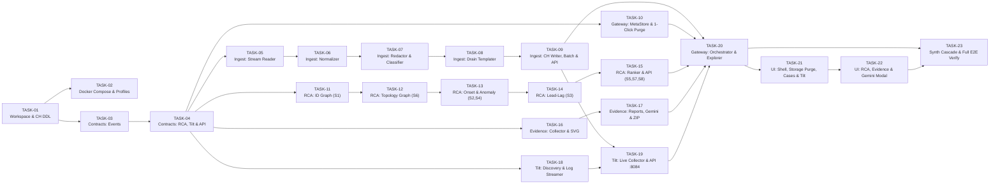

# Архитектура и план реализации RCA Logs Analyzer (Blueprint под ИИ-агентов)

> Документ фиксирует целевую микросервисную архитектуру, бюджет ресурсов (`1–2 ГБ RAM`, `15 ГБ диска`), посимвольные схемы БД, межсервисные и фронтенд-контракты, а также декомпозицию на **23 атомарные задачи** для ИИ-агентов (**Gemini 3.8 Flash High**).
> Общее описание возможностей: [SERVICE_DESCRIPTION.md](./SERVICE_DESCRIPTION.md).

---

## 1. Принципы архитектуры (под разработку агентами Gemini Flash High)

1. **Строгая микросервисная декомпозиция + атомарность задач («1 задача = 1–2 файла кода + 1 файл тестов»).**
   Система разделена на **5 Go-микросервисов** (`ingest-service`, `rca-engine`, `evidence-service`, `tilt-collector`, `gateway-api`), **1 фронтенд-сервис** и **ClickHouse**, объединённых единым пакетом контрактов `./pkg/contracts`:
   - полный объём одного микросервиса со всеми проверками и тестами составляет **1 200–1 800 строк кода**;
   - каждый микросервис разбит на 3–5 атомарных задач (`TASK-XX`) объёмом **250–450 строк полного, рабочего кода на одну задачу**;
   - **СТРОГИЙ ЗАПРЕТ НА ЗАГЛУШКИ (`// TODO`, `// implement later`, пустые функции):** агент обязан реализовать 100% алгоритма задачи;
   - все сигнатуры функций между пакетами, SQL-запросы ClickHouse и защиты от `NaN`/деления на ноль выписаны прямо в файлах `./tasks/TASK-XX-...md`.
2. **Полная сетевая изоляция (`Air-Gapped Local Docker`).**
   Все сервисы запускаются локально через `docker compose`. Внутренняя сеть помечена `internal: true`, а проброс портов на хост ограничен `127.0.0.1:4300` (UI) и `127.0.0.1:8080` (API Gateway). Ни один сервис не делает внешних HTTP-запросов.
3. **Жёсткий бюджет ресурсов: 1–2 ГБ RAM и 15 ГБ диска.**
   Go-микросервисы потребляют 20–60 МБ RAM, а ClickHouse ограничен двумя профилями (`low_memory.xml` = 768 МБ на сервер и `low_memory_profile.xml` = 384 МБ на запрос, `max_threads=2`).

---

## 2. Бюджет ресурсов (RAM и Диск)

### 2.1. Оперативная память (потолок 1648 МБ ≈ 1.61 ГБ — укладывается в 1–2 ГБ RAM)

| Контейнер | Технология | Обычное потребление | Жёсткий `mem_limit` в Docker | Роль |
|---|---|---|---|---|
| `clickhouse` | ClickHouse Server 24.8 Alpine | 350–650 МБ | **896m** (`max_server_memory_usage=768MB`) | Колоночное хранение `events_raw`, агрегатов и графов |
| `ingest-service` | Go 1.23 | 30–120 МБ | **224m** | Потоковый парсинг файлов и батчей из Tilt, маскирование секретов, Drain, батч-запись |
| `rca-engine` | Go 1.23 | 25–100 МБ | **192m** | Расчёт 8 сигналов RCA, граф идентификаторов, ранжирование гипотез |
| `evidence-service` | Go 1.23 | 20–60 МБ | **128m** | Сборка артефактов `E-xx`, SVG-графиков, `report.md/html`, `gemini_bundle.md`, `.zip` |
| `gateway-api` | Go 1.23 | 20–50 МБ | **96m** | Единый API для UI, метаданные кейсов, контроль квоты 15 ГБ, кнопка «Очистить сырые логи» |
| `tilt-collector` | Go 1.23 | 15–40 МБ | **64m** | Автообнаружение сервисов локального Tilt (Docker / k8s) и живой стриминг их логов в `ingest-service` |
| `frontend-ui` | React 19 + TypeScript + Nginx | 10–20 МБ | **48m** | Веб-интерфейс на `http://127.0.0.1:4300` |
| **ИТОГО** | | **~470–1040 МБ** | **1648 МБ (~1.61 ГБ)** | |

### 2.2. Дисковый бюджет (потолок 15 ГБ)

| Сегмент | Путь в volume `/data` | Квота | Политика очистки |
|---|---|---|---|
| Сырые события `events_raw` + `identity_edges` | `/var/lib/clickhouse` | **до 10.0 ГБ** | TTL 3 дня + автоудаление старых партиций при превышении 10 ГБ + **кнопка «Очистить сырые логи» в 1 клик** |
| Временные файлы загрузки (`staging`) | `/data/staging` | **до 1.5 ГБ** | Удаляются сразу после завершения инжеста или кнопкой очистки |
| Долгосрочные агрегаты `events_agg_1m` + шаблоны | `/var/lib/clickhouse` | **до 1.5 ГБ** | TTL 180 дней (не удаляются кнопкой очистки сырых логов) |
| Отчёты, артефакты `E-xx`, `gemini_bundle.md`, SQLite | `/data/reports`, `/data/meta` | **до 2.0 ГБ** | Хранятся бессрочно до ручного удаления кейса |

---

## 3. Структура репозитория

```text
./
├── README.md                       # Инструкция по переносу и запуску агентов
├── SERVICE_DESCRIPTION.md          # Описание функционала и возможностей сервиса
├── ARCHITECTURE_AND_PLAN.md        # Архитектура, контракты, схемы БД и план (этот файл)
├── AGENTS_PROGRESS.md              # Входная точка для ИИ-агентов и таблица прогресса 21 задачи
├── tasks/                          # Подробные чертежи по каждой задаче (TASK-01 .. TASK-21)
├── docker-compose.yml              # Оркестрация всех контейнеров с mem_limit и internal network
├── go.work                         # Go workspace для 5 модулей
├── config/
│   └── service_profiles.yaml       # Декларативные правила парсинга/ID и статические связи сервисов
├── deploy/
│   └── clickhouse/
│       ├── low_memory.xml          # Ограничение памяти сервера ClickHouse до 768 МБ
│       ├── low_memory_profile.xml  # Ограничение памяти на запрос (384 МБ) и потоков (max_threads=2)
│       └── init_schema.sql         # Полный DDL таблиц и Materialized View
├── pkg/
│   └── contracts/                  # Общий Go-модуль структур данных и DTO (без бизнес-логики)
├── services/
│   ├── ingest-service/             # Микросервис 1 (:8081): чтение файлов и батчей Tilt, парсинг, маскирование, Drain
│   ├── rca-engine/                 # Микросервис 2 (:8082): корреляции, аномалии, графы, ранжирование причин
│   ├── evidence-service/           # Микросервис 3 (:8083): генерация E-xx, report.md/html, gemini_bundle.md
│   ├── tilt-collector/             # Микросервис 4 (:8084): автообнаружение сервисов локального Tilt и живой захват логов
│   ├── gateway-api/                # Микросервис 5 (:8080): фасад для UI, метаданные, управление диском и очисткой
│   └── frontend-ui/                # Микросервис 6 (:4300): React + TypeScript + Nginx
├── tools/
│   └── synthgen/                   # Генератор синтетических мультисервисных инцидентов и E2E-тесты
├── import/                         # Папка для подкладывания файлов логов с хоста
└── log_example/                    # Эталонные примеры реальных логов (chat-com, chat-session)
```

---

## 4. Полная схема БД ClickHouse (`./deploy/clickhouse/init_schema.sql`)

```sql
CREATE DATABASE IF NOT EXISTS logs_rca;

-- 1. Сырые нормализованные события (горячий слой, очищается кнопкой в 1 клик или по TTL 3 дня)
CREATE TABLE IF NOT EXISTS logs_rca.events_raw (
    case_id           LowCardinality(String),
    event_id          UUID,
    ts                DateTime64(9, 'UTC'),
    app_ts            Nullable(DateTime64(9, 'UTC')),
    clock_skew_ms     Int64 DEFAULT 0,
    service           LowCardinality(String),
    environment       LowCardinality(String),
    pod               LowCardinality(String),
    node              LowCardinality(String),
    service_version   LowCardinality(String),
    level             LowCardinality(String),      -- ERROR, WARN, INFO, DEBUG
    severity_num      UInt8,                       -- 40=ERROR, 30=WARN, 20=INFO, 10=DEBUG
    schema_kind       LowCardinality(String),      -- go_slog, py_tornado, echo_access, otel_http, generic_json, plain
    template_id       UInt64,
    message           String CODEC(ZSTD(3)),
    error_class       LowCardinality(String),      -- NONE, CANCELED, DEADLINE, UNAVAILABLE, PEER_5XX, PEER_4XX, OWN_DEFECT, RESOURCE
    error_msg         String CODEC(ZSTD(3)),
    exception_type    LowCardinality(String),
    source_place      LowCardinality(String),      -- например "cache:98" или "client.go:173"
    stack_fingerprint UInt64 DEFAULT 0,
    trace_id          String CODEC(ZSTD(1)),
    span_id           String CODEC(ZSTD(1)),
    request_id        String CODEC(ZSTD(1)),
    session_id        String CODEC(ZSTD(1)),
    operator_id       String CODEC(ZSTD(1)),
    visitor_id        String CODEC(ZSTD(1)),
    http_method       LowCardinality(String),
    http_route        LowCardinality(String),
    http_status       UInt16 DEFAULT 0,
    latency_ns        UInt64 DEFAULT 0,
    peer_service      LowCardinality(String),
    source_file       LowCardinality(String),
    source_record_idx UInt32,
    raw_hash          UInt64,
    raw_redacted      String CODEC(ZSTD(5))
)
ENGINE = ReplacingMergeTree(ts)
PARTITION BY (case_id, toYYYYMMDD(ts))
ORDER BY (case_id, service, ts, pod, raw_hash)
TTL toDateTime(ts) + INTERVAL 3 DAY DELETE
SETTINGS index_granularity = 8192;

-- 2. Долгосрочные минутные агрегаты (хранятся 180 дней, НЕ удаляются при очистке сырых логов)
CREATE TABLE IF NOT EXISTS logs_rca.events_agg_1m (
    case_id           LowCardinality(String),
    bucket_1m         DateTime('UTC'),
    service           LowCardinality(String),
    pod               LowCardinality(String),
    service_version   LowCardinality(String),
    level             LowCardinality(String),
    error_class       LowCardinality(String),
    template_id       UInt64,
    source_place      LowCardinality(String),
    peer_service      LowCardinality(String),
    http_status_class UInt8,                       -- 0, 2, 4, 5
    events_count      UInt64,
    latency_sum_ns    UInt64,
    latency_max_ns    SimpleAggregateFunction(max, UInt64),
    clock_skew_abs_ms SimpleAggregateFunction(max, UInt64)
)
ENGINE = SummingMergeTree()
PARTITION BY toYYYYMM(bucket_1m)
ORDER BY (case_id, service, bucket_1m, level, error_class, template_id, pod, source_place, peer_service, http_status_class)
TTL bucket_1m + INTERVAL 180 DAY DELETE;

-- Materialized View для автоматического наполнения events_agg_1m при вставке в events_raw
CREATE MATERIALIZED VIEW IF NOT EXISTS logs_rca.mv_events_agg_1m
TO logs_rca.events_agg_1m
AS SELECT
    case_id,
    toStartOfMinute(ts) AS bucket_1m,
    service,
    pod,
    service_version,
    level,
    error_class,
    template_id,
    source_place,
    peer_service,
    toUInt8(intDiv(http_status, 100)) AS http_status_class,
    count() AS events_count,
    sum(latency_ns) AS latency_sum_ns,
    max(latency_ns) AS latency_max_ns,
    max(toUInt64(abs(clock_skew_ms))) AS clock_skew_abs_ms
FROM logs_rca.events_raw
GROUP BY
    case_id, bucket_1m, service, pod, service_version,
    level, error_class, template_id, source_place, peer_service, http_status_class;

-- 3. Справочник шаблонов (сохраняется вместе с агрегатами)
CREATE TABLE IF NOT EXISTS logs_rca.templates_dict (
    case_id           LowCardinality(String),
    service           LowCardinality(String),
    template_id       UInt64,
    template_text     String,
    level             LowCardinality(String),
    error_class       LowCardinality(String),
    source_place      LowCardinality(String),
    sample_redacted   String CODEC(ZSTD(3)),
    first_seen        DateTime64(9, 'UTC'),
    last_seen         DateTime64(9, 'UTC')
)
ENGINE = ReplacingMergeTree(last_seen)
ORDER BY (case_id, service, template_id);

-- 4. Граф связей идентификаторов (id <-> X-Request-Id <-> trace_id <-> session_id <-> visitor_id)
CREATE TABLE IF NOT EXISTS logs_rca.identity_edges (
    case_id           LowCardinality(String),
    ts                DateTime64(9, 'UTC'),
    service           LowCardinality(String),
    left_type         LowCardinality(String),      -- request_id, trace_id, session_id, visitor_id
    left_val          String,
    right_type        LowCardinality(String),
    right_val         String
)
ENGINE = ReplacingMergeTree(ts)
PARTITION BY case_id
ORDER BY (case_id, left_type, left_val, right_type, right_val);

-- 5. Автоматически обнаруженные рёбра топологии сервисов
CREATE TABLE IF NOT EXISTS logs_rca.service_edges (
    case_id           LowCardinality(String),
    caller_service    LowCardinality(String),
    callee_service    LowCardinality(String),
    evidence_source   LowCardinality(String),      -- peer_url, trace_propagation, session_bridge, static_config
    call_count        UInt64,
    error_count       UInt64
)
ENGINE = SummingMergeTree()
ORDER BY (case_id, caller_service, callee_service, evidence_source);

-- 6. Реестр загруженных файлов (защита от повторной загрузки и двойного счёта в SummingMergeTree)
CREATE TABLE IF NOT EXISTS logs_rca.ingested_files (
    case_id           LowCardinality(String),
    file_sha256       FixedString(64),
    file_name         String,
    rows_ingested     UInt64,
    ingested_at       DateTime('UTC') DEFAULT now()
)
ENGINE = ReplacingMergeTree(ingested_at)
ORDER BY (case_id, file_sha256);
```

---

## 5. Декомпозиция плана на 23 атомарные задачи


