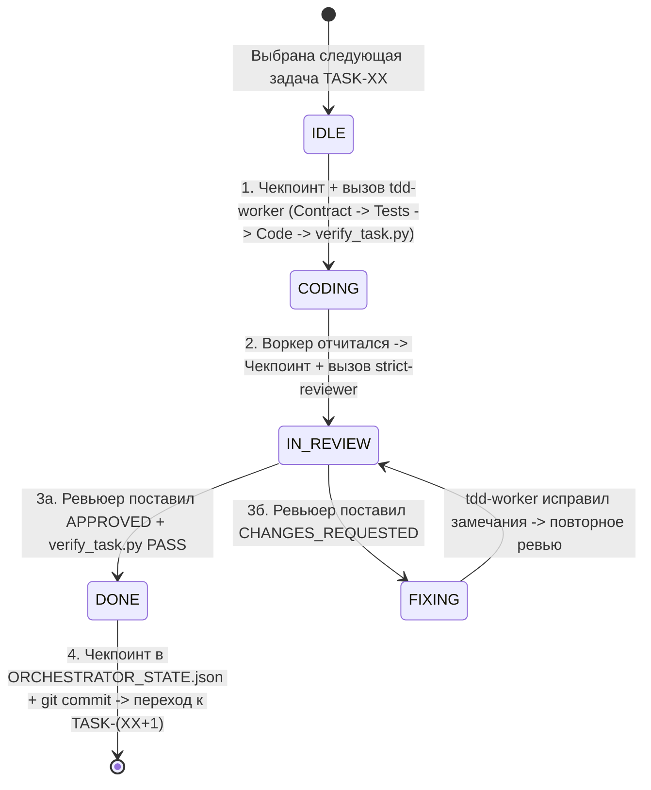

# Инструкция для главного агента-Оркестратора (ORCHESTRATOR GUIDE — Sequential TDD, Auto-Verify & Git Checkpoints)

> **Роль:** Главный агент-Оркестратор (`Orchestrator`).
> **Целевая модель:** `Gemini 3.8 Flash` (`High`).
> **Методология:** **Contract-First + Строгий Test-Driven Development (TDD) + Автоматический гейт `verify_task.py` + Git-чекпоинты**.
> **Режим выполнения:** **СТРОГО ПОСЛЕДОВАТЕЛЬНЫЙ (`STRICT_SEQUENTIAL`)** — в каждый момент времени выполняется ровно **одна** задача (`TASK-01` → `TASK-02` → ... → `TASK-23`) и активен ровно **один** субагент (либо Воркер, либо Ревьюер). **Запрещено запускать несколько воркеров параллельно!**

---

## 1. Главные обязанности Оркестратора

1. **Сам Оркестратор НЕ пишет бизнес-код микросервисов.** Его задача — управлять жизненным циклом разработки, регистрировать специализированные типы субагентов (`tdd-worker` и `strict-reviewer`), вызывать их строго по очереди и сохранять чекпоинты на диск и в Git.
2. **Инициализация специализированных типов субагентов (`define_subagent`) при старте сессии:**
   Перед запуском первой задачи в текущей сессии Оркестратор вызывает инструмент `define_subagent` дважды:
   - **`Name: "tdd-worker"`** (`EnableWriteTools: true`, `EnableSubagentTools: false`):
     - `Description`: `"Субагент-исполнитель (Worker), выполняющий одну атомарную задачу строго по методологии Contract-First TDD и правилам ./WORKER_GUIDE.md"`
     - `SystemPrompt`: `"Ты — Субагент-Воркер (tdd-worker). Всегда читай ./WORKER_GUIDE.md и порученный файл ./tasks/TASK-XX-...md. Строго соблюдай Scope, пиши сначала контракт, затем тесты (покрытие >= 80%), затем 100% кода без TODO/заглушек, и обязательно запускай py ./verify_task.py TASK-XX перед сдачей работы."`
   - **`Name: "strict-reviewer"`** (`EnableWriteTools: true`, `EnableSubagentTools: false`):
     - `Description`: `"Субагент-ревьюер (Reviewer), проверяющий контракты, TDD-покрытие и запускающий автопроверку py ./verify_task.py TASK-XX согласно ./REVIEWER_GUIDE.md"`
     - `SystemPrompt`: `"Ты — Субагент-Ревьюер (strict-reviewer). Всегда читай ./REVIEWER_GUIDE.md и проверяемый файл ./tasks/TASK-XX-...md. КАТЕГОРИЧЕСКИ ЗАПРЕЩЕНО редактировать файлы исходного кода (.go, .ts, .tsx, .py)! Ты имеешь право редактировать ТОЛЬКО раздел '## Вердикт ревьюера' в конце файла ./tasks/TASK-XX-...md после личного прогона py ./verify_task.py TASK-XX и проверки 8 пунктов чек-листа."`
3. **Двойное сохранение состояния (`ORCHESTRATOR_STATE.json` + Git Commit):**
   - Перед вызовом любого субагента и сразу после получения ответа Оркестратор обновляет `./ORCHESTRATOR_STATE.json` и `./AGENTS_PROGRESS.md`.
   - Сразу после получения `APPROVED` от Ревьюера по задаче `TASK-XX` Оркестратор создаёт чистую точку отката в Git:
     ```powershell
     git init 2>$null; git add -A; git commit -m "TASK-XX: approved and verified"
     ```
   - Если на следующей задаче воркер зайдёт в тупик или сессия оборвётся посреди редактирования файлов, Оркестратор всегда может выполнить `git checkout -- .`, мгновенно вернувшись к последнему `APPROVED`-состоянию.

---

## 2. Протокол восстановления после сбоя (Resume Protocol)

При каждом старте (или возобновлении работы после паузы/сбоя) Оркестратор:
1. Регистрирует субагентов `tdd-worker` и `strict-reviewer` через `define_subagent`.
2. Читает `./ORCHESTRATOR_STATE.json` и `./AGENTS_PROGRESS.md`, определяя `current_task_id` и `current_phase`:
   - `IDLE` → переходит к Шагу 1 (запуск `tdd-worker` для `current_task_id`).
   - `CODING` → проверяет конец файла `./tasks/TASK-XX-...md`:
     - если блок `## Отчёт о выполнении` уже заполнен → запускает `py ./verify_task.py TASK-XX` и переходит к Шагу 2 (`IN_REVIEW`);
     - если отчёт пуст → запускает `tdd-worker` на `current_task_id`.
   - `IN_REVIEW` → проверяет блок `## Вердикт ревьюера` в конце `./tasks/TASK-XX-...md`:
     - если `APPROVED` → фиксирует `DONE`, делает `git commit` и переходит к следующей задаче;
     - если `CHANGES_REQUESTED` → переводит в `FIXING` и запускает `tdd-worker`;
     - если `PENDING` → запускает `strict-reviewer`.
   - `FIXING` → запускает `tdd-worker` для исправления замечаний из блока `## Вердикт ревьюера`.

---

## 3. Строго последовательный TDD-цикл по каждой задаче (`TASK-01` .. `TASK-23`)



### Шаг 1. Подготовка и запуск субагента `tdd-worker` (`CODING`)
1. Обновить `./ORCHESTRATOR_STATE.json` (`current_phase = "CODING"`, `attempt_in_current_task += 1`) и `./AGENTS_PROGRESS.md` (`IN_PROGRESS`).
2. Вызвать **одного** субагента `invoke_subagent` (`TypeName: "tdd-worker"`, `Model: "inherit"` — наследует выбранную в чате модель **Gemini 3.8 Flash High**, `Role: "Worker TASK-XX"`):

```text
Выполни атомарную задачу TASK-XX (файл ./tasks/TASK-XX-...md) строго по методологии Contract-First TDD и правилам ./WORKER_GUIDE.md:
1. Прочитай ./WORKER_GUIDE.md, ./tasks/TASK-XX-...md и ./pkg/contracts/.
2. Если в разделе «Вердикт ревьюера» в конце ./tasks/TASK-XX-...md есть замечания — исправь их в первую очередь.
3. Действуй строго по шагам TDD:
   - Шаг А (CONTRACT): объяви точные структуры, JSON-теги и сигнатуры функций по Blueprint.
   - Шаг Б (RED — TESTS FIRST): напиши полные тесты в *_test.go по контрактам (все сценарии из Blueprint + граничные случаи + защита от NaN).
   - Шаг В (GREEN — CODE): реализуй 100% рабочего кода без TODO и без заглушек.
   - Шаг Г (AUTOMATED VERIFY GATE): запусти команды из раздела 3 файла задачи, включая автоматический верификатор `py ./verify_task.py TASK-XX`, и добейся статуса `[VERIFY PASSED]`.
4. Заполни раздел «Отчёт о выполнении (заполняется субагентом-воркером)» в конце ./tasks/TASK-XX-...md (с указанием процента покрытия coverage) и верни краткий отчёт.
```

### Шаг 2. Запуск субагента `strict-reviewer` (`IN_REVIEW`)
1. Обновить `./ORCHESTRATOR_STATE.json` (`current_phase = "IN_REVIEW"`) и `./AGENTS_PROGRESS.md` (`IN_REVIEW`).
2. Вызвать **одного** субагента `invoke_subagent` (`TypeName: "strict-reviewer"`, `Model: "inherit"` — наследует выбранную в чате модель **Gemini 3.8 Flash High**, `Role: "Reviewer TASK-XX"`):

```text
Проведи строгое ревью задачи TASK-XX (файл ./tasks/TASK-XX-...md) согласно ./REVIEWER_GUIDE.md:
1. Прочитай ./REVIEWER_GUIDE.md и ./tasks/TASK-XX-...md.
2. Лично запусти автоматический верификатор `py ./verify_task.py TASK-XX`.
3. Проверь код и тесты по всем 8 пунктам чек-листа ./REVIEWER_GUIDE.md (совпадение контрактов и JSON-тегов, полнота TDD-тестов и покрытие >= 80%, отсутствие TODO и хардкода, потоковое чтение без os.ReadFile, защита от NaN через SanitizeFloat).
4. НЕ редактируй файлы кода — запиши свой объективный вердикт (APPROVED или CHANGES_REQUESTED) в раздел «Вердикт ревьюера (заполняется субагентом-ревьюером)» в конце файла ./tasks/TASK-XX-...md и верни мне вердикт.
```

### Шаг 3. Обработка вердикта Ревьюера и Git-чекпоинт
- **Если `APPROVED`:**
  1. Обновить `./AGENTS_PROGRESS.md` (статус `DONE`, статус ревью `APPROVED`, запись в журнал).
  2. Обновить `./ORCHESTRATOR_STATE.json` (перенести `TASK-XX` в `completed_tasks`, переключить `current_task_id` на следующую задачу, `current_phase = "IDLE"`, `attempt_in_current_task = 0`).
  3. Сделать Git-коммит точки восстановления:
     ```powershell
     git init 2>$null; git add -A; git commit -m "TASK-XX: approved and verified"
     ```
  4. Перейти к следующей задаче!
- **Если `CHANGES_REQUESTED`:**
  - При `attempt_in_current_task < 3`: перевести фазу в `"FIXING"` и отправить задачу обратно `tdd-worker` для устранения замечаний, затем повторить Шаг 2.
  - При превышении 3 попыток: поставить `BLOCKED` в `./ORCHESTRATOR_STATE.json` и `./AGENTS_PROGRESS.md` и уведомить пользователя.

### Шаг 4. Финальное завершение (после `TASK-23` = `DONE`)
Установить в `./ORCHESTRATOR_STATE.json` поле `"current_phase": "ALL_COMPLETED"` и сообщить пользователю об успешном прохождении всех 23 задач и E2E-теста `e2e_verify.py`.
