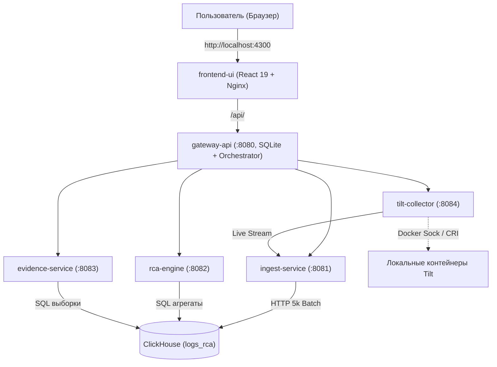

# RCA Logs Analyzer — Руководство пользователя и инструкция по развёртыванию

**RCA Logs Analyzer** — это локальная, полностью изолированная от внешней сети (`air-gapped`) платформа анализа распределённых логов и автоматического выявления первопричин сбоев (**Root Cause Analysis**).

Система спроектирована для расследования каскадных аварий в микросервисных архитектурах (от 5 до 15+ сервисов) в условиях жёстких ограничений локального ПК: **до 1.6 ГБ RAM** и **до 15 ГБ диска**.

---

## Оглавление
1. [Архитектура и ключевые возможности](#1-архитектура-и-ключевые-возможности)
2. [Системные требования и порты](#2-системные-требования-и-порты)
3. [Быстрый старт: развёртывание за 1 минуту](#3-быстрый-старт-развёртывание-за-1-минуту)
4. [Подробное руководство пользователя](#4-подробное-руководство-пользователя)
   - [4.1. Обзор веб-интерфейса](#41-обзор-веб-интерфейса)
   - [4.2. Шаг 1: Создание кейса расследования](#42-шаг-1-создание-кейса-расследования)
   - [4.3. Шаг 2: Загрузка логов (3 способа)](#43-шаг-2-загрузка-логов-3-способа)
   - [4.4. Шаг 3: Запуск и анализ гипотез RCA](#44-шаг-3-запуск-и-анализ-гипотез-rca)
   - [4.5. Шаг 4: Анализ цепочек вызовов и контекста логов](#45-шаг-4-анализ-цепочек-вызовов-и-контекста-логов)
   - [4.6. Шаг 5: Доказательства, экспорт отчётов и Copy for Gemini](#46-шаг-5-доказательства-экспорт-отчётов-и-copy-for-gemini)
   - [4.7. Шаг 6: Управление диском и очистка в 1 клик](#47-шаг-6-управление-диском-и-очистка-в-1-клик)
5. [Синтетический демо-инцидент и E2E проверка](#5-синтетический-демо-инцидент-и-e2e-проверка)
6. [Управление контейнерами и траблшутинг](#6-управление-контейнерами-и-траблшутинг)
7. [Безопасность и PII-маскирование](#7-безопасность-и-pii-маскирование)

---

## 1. Архитектура и ключевые возможности

Платформа состоит из 7 автономных сервисов, объединённых в закрытую сеть Docker Compose:



### Ключевые возможности:
1. **Live-захват из Tilt / Local Kubernetes:** автообнаружение локальных подов/контейнеров по меткам `dev.tilt.resource` / Docker и потоковая передача живых логов в систему в 1 клик.
2. **Универсальный нормализатор (6 схем):** автоматическое распознавание форматов JSON, JSONL, Docker/Kubernetes CRI, LogQL-дампов, архивов `.gz` и `.zip`.
3. **Исправление ложных статусов Loki:** автоматическая реклассификация HTTP 200/204 с пустым `"error": ""` из ложного `error` в честный `INFO`.
4. **Детектор рассинхрона часов (Clock Skew):** находит сервисы со сдвинутыми часами (например, контейнеры с расхождением на 2 часа).
5. **Маскирование секретов и PII:** удаление Bearer JWT токенов, паролей, email и публичных IP на лету.
6. **RCA-ранжирование по 8 сигналам:** автоматическая классификация всех событий на:
   - 🔴 **`ROOT_CAUSE` (Первопричина):** точный сервис, pod, файл и строка кода (`source_place`), где зародился сбой.
   - 🟠 **`PROPAGATION` (Распространение):** таймауты и ошибки 5xx при обращении к упавшему сервису.
   - 🟡 **`SYMPTOM` (Симптом):** клиентские ошибки 502/504 и отмены запросов `context canceled`.
   - ⚪ **`NOISE` (Шум):** фоновые ошибки, частота которых не изменилась во время аварии (например, промахи кэша).
7. **Пакет для Google Gemini в 1 клик:** генерация готового промпта с уликами `[E-01..E-NN]` для отправки в LLM.
8. **1-клик очистка сырых логов (`Purge Raw`):** мгновенное освобождение диска с полным сохранением отчётов и истории за 180 дней.

---

## 2. Системные требования и порты

### Минимальные требования:
- **ОС:** Windows 10/11 (WSL2), macOS (Apple Silicon / Intel), Linux (Ubuntu 20.04+).
- **RAM:** от 4 ГБ физической памяти (контейнеры ограничены лимитом **1648 МБ RAM** суммарно).
- **Диск:** от 2 ГБ свободного места для образов + до 15 ГБ под логи.
- **ПО:** Docker Engine 24+ / Docker Desktop с поддержкой Docker Compose v2.

### Используемые порты на хосте:
| Порт хоста | Назначение | Доступность |
|---|---|---|
| **`4300`** | Веб-интерфейс пользователя (Frontend UI) | Открыт в браузере (`http://localhost:4300`) |
| **`8080`** | Публичный REST API (Gateway API) | Открыт локально (`http://localhost:8080/api/v1`) |
| **`8123`** | ClickHouse HTTP Interface | Доступен для DBeaver / curl при отладке |
| **`9000`** | ClickHouse Native Protocol | Доступен для clickhouse-client |
| `8081..8084` | Внутренние микросервисы | Изолированы во внутренней сети `internal: true` |

---

## 3. Быстрый старт: развёртывание за 1 минуту

### Шаг 1. Клонирование / переход в каталог проекта
```bash
cd rca-project
```

### Шаг 2. Запуск контейнеров одной командой
```bash
docker compose up -d --build
```
> При первом запуске Docker скачает базовые образы (`node:22-alpine`, `golang:1.23-alpine`, `clickhouse/clickhouse-server:24.8-alpine`), соберёт микросервисы и инициализирует базу данных. Это займёт 1–2 минуты.

### Шаг 3. Проверка статуса запуска
Выполните команду проверки состояния:
```bash
docker compose ps
```
Все 7 контейнеров должны иметь статус `running` (`Up`):
- `rca-clickhouse`
- `rca-ingest`
- `rca-engine`
- `rca-evidence`
- `rca-tilt-collector`
- `rca-gateway`
- `rca-frontend`

Проверка доступности API через терминал:
```bash
curl http://127.0.0.1:8080/api/v1/health
# Ответ: {"status":"OK","time":"..."}
```

### Шаг 4. Открытие приложения
Откройте браузер по адресу:
👉 **[http://localhost:4300](http://localhost:4300)**

---

## 4. Подробное руководство пользователя

### 4.1. Обзор веб-интерфейса

Интерфейс разделен на 3 функциональные зоны:
1. **Верхняя панель диска (Storage Header):**
   - Индикатор 15 ГБ дисковой квоты с цветовым делением:
     - 🟣 **Сырые логи (`raw_bytes`)** — строки логов в ClickHouse;
     - 🔵 **Агрегаты (`agg_bytes`)** — 1-минутные метрики и шаблоны Drain;
     - 🟢 **Отчёты (`reports_bytes`)** — сохранённые Markdown, HTML и архивы улики;
     - ⚪ **Свободное место**.
   - Кнопка **«Очистить сырые логи»** — мгновенно удаляет тяжёлые сырые данные, сохраняя результаты расследования.
2. **Левая боковая панель (Case Sidebar):**
   - Список кейсов инцидентов с их статусами.
   - Кнопка создания нового кейса.
   - Инструменты импорта: выбор локальных файлов, Drag-and-Drop загрузка, Live-захват из Tilt.
   - Кнопка **«Запустить анализ RCA»**.
3. **Центральная рабочая область:**
   - Вкладка **RCA Hypotheses & Topology** — карточки первопричин, интерактивный граф топологии (SVG) и таймлайн ошибок (SVG).
   - Вкладка **Evidence & Reports** — инспектор улик `[E-01..E-NN]`, скачивание HTML/ZIP, кнопка **«Copy for Gemini»**.
   - Вкладка **Log Explorer** — поиск и контекст логов `±20 строк`.

---

### 4.2. Шаг 1: Создание кейса расследования

1. В левой колонке нажмите кнопку **«+ Новый кейс»**.
2. В появившемся модальном окне укажите:
   - **Название:** например, *«Падение оформления заказов 28 октября»*.
   - **Описание:** краткие симптомы (например, *«Пользователи жалуются на HTTP 502 при переходе в корзину»*).
3. Нажмите **«Создать»**. Созданный кейс станет активным.

---

### 4.3. Шаг 2: Загрузка логов (3 способа)

Система предлагает 3 гибких варианта загрузки данных:

#### Вариант А: Быстрый выбор из локальной папки `/import` (Рекомендуется для больших дампов)
1. Скопируйте файлы логов на хосте в директорию `./import/` (или `./import/synth_cascade/`).
2. В блоке **«Локальные файлы (/import)»** сайдбара появятся все доступные файлы с их размером и датой.
3. Отметьте нужные файлы галочками (или нажмите *«Выбрать все»*).
4. Нажмите кнопку **«Импортировать выбранные»**.
5. Сервис начнёт потоковую загрузку батчами. Вы увидите прогресс: число загруженных строк, прочитанный объём и предупреждения о рассинхроне времени.

#### Вариант Б: Загрузка через браузер (Drag & Drop)
1. В секции **«Загрузка файлов»** сайдбара перетащите мышью файлы `.json`, `.jsonl`, `.gz` или `.zip` в пунктирную область (или нажмите *«Обзор»*).
2. Нажмите кнопку **«Загрузить»**. Файлы будут переданы в `gateway-api` потоковыми чанками по 256 КБ без переполнения памяти браузера.

#### Вариант В: Live-захват логов из локального Tilt
Если вы разрабатываете сервисы локально через Tilt / Docker Compose / Minikube:
1. В секции **«Live захват из Tilt / Local Runtime»** вы увидите список автоматически обнаруженных контейнеров (например, `api-gateway`, `order-service`, `billing-db`).
2. Выберите глубину захвата (пресеты: `1 мин`, `5 мин`, `15 мин` или введите секунды вручную).
3. Нажмите кнопку **«Начать захват из Tilt»**.
4. Загорится зелёный пульсирующий индикатор **«Захват активен»**, и счётчик строк начнёт увеличиваться в реальном времени.
5. Воспроизведите ошибку в приложении.
6. Нажмите **«Остановить захват»**. Все собранные логи сохранены в текущий кейс.

---

### 4.4. Шаг 3: Запуск и анализ гипотез RCA

1. Нажмите зелёную кнопку **«Запустить анализ RCA»** в сайдбаре.
2. При необходимости в модальном окне можно включить опцию *«Использовать 180-дневный исторический baseline»*.
3. Нажмите **«Анализировать»**. Система обработает данные по алгоритму 8 сигналов и отобразит ранжированный список гипотез:

#### Структура карточки гипотезы:
- **Бейдж роли:**
  - 🔴 **`ROOT_CAUSE` (Красный)** — источник аварии.
  - 🟠 **`PROPAGATION` (Оранжевый)** — следствие каскадного сбоя.
  - 🟡 **`SYMPTOM` (Жёлтый)** — внешний симптом.
  - ⚪ **`NOISE` (Серый)** — фоновый шум.
- **Точная локализация:** строка вида `service → dominant_pod → source_place → dominant_route`
  *(например: `billing-db-proxy → billing-db-proxy-7f9c → pool_manager.go:84 → /query`).*
- **Всплеск частоты (Anomaly Onset):** точное время начала аварии (`OnsetTime`), частота до сбоя, частота во время сбоя и кратность роста (`growth_ratio`, например `×60.0`).
- **Бейдж «Повторный инцидент»:** если аналогичный шаблон ошибки встречался в более ранних кейсах, система отобразит `Recurring in: case-xxxx`.
- **Шкала 8 сигналов (`S1..S8`):** наглядная визуализация весов:
  - `S1 Trace Chain` — покрытие сквозной цепочки вызовов;
  - `S2 Onset Time` — временное опережение по отношению к другим сервисам;
  - `S3 Lead-Lag` — кросс-корреляция Пирсона $r(\tau)$ с опережением сбоев соседей;
  - `S4 Novelty` — новизна ошибки относительно baseline;
  - `S5 Error Class` — вес класса ошибки (`OWN_DEFECT` / `RESOURCE` выше, чем `PEER_TIMEOUT`);
  - `S6 Graph Root` — положение сервиса в графе зависимостей (источник, а не сток);
  - `S7 Pod Skew` — перекос сбоев на конкретный pod или ноду;
  - `S8 Route Localization` — локализация ошибки на конкретный эндпоинт.

---

### 4.5. Шаг 4: Анализ цепочек вызовов и контекста логов

#### Интерактивные графики (SVG):
- **Временная шкала (Timeline):** распределение событий по времени с разбивкой по сервисам и уровням логов (`error`, `warn`, `info`).
- **Топология сервисов (Service Graph):** ориентированный граф вызовов с подсчётом общего числа запросов и доли ошибок на каждом ребре.

#### Поиск сквозной цепочки вызовов:
1. В блоке **«Сквозная цепочка запроса»** введите известный идентификатор (`request_id`, `trace_id` или `session_id`).
2. Нажмите **«Найти цепочку»**.
3. Отобразится пошаговый маршрут прохождения запроса через микросервисы со статусами и таймстампами.

#### Просмотр контекста логов `±20 строк`:
1. Нажмите кнопку **«Контекст логов»** рядом с любой гипотезой или уликой.
2. Откроется окно с 40 строками вокруг момента инцидента.
3. Доступны два режима:
   - **Режим Pod:** логи только конкретного пода, где произошла авария;
   - **Режим Все сервисы:** синхронный срез логов всех микросервисов в радиусе 10 секунд.
> 💡 Если сырые логи были очищены кнопкой *Purge Raw*, интерфейс корректно отобразит предупреждение `RawPurged: true` и покажет сохранённые агрегированные данные.

---

### 4.6. Шаг 5: Доказательства, экспорт отчётов и Copy for Gemini

Перейдите на вкладку **«Evidence & Reports»**:

1. **Инспектор доказательств `[E-01 .. E-NN]`:**
   - Каждая строка содержит: ID улики, сервис, имя исходного файла, номер строки, хэш `SHA-256`, маскированный текст и готовый сниппет `LogQL` для Grafana/Loki.
   - Кнопка **«Копировать LogQL»** позволяет в 1 клик перенести фильтр в вашу систему мониторинга.
2. **Экспорт отчётов:**
   - **`Скачать report.md`** — отчёт расследования в формате Markdown.
   - **`Скачать report.html`** — автономный HTML-отчёт с встроенными SVG-графиками (открывается в любом браузере без интернета).
   - **`Скачать evidence.zip`** — полный архив всех артефактов и JSON-дампов доказательств.
3. **Модальное окно «Пакет для Google Gemini» (Copy for Gemini):**
   - Нажмите кнопку **«Пакет для Google Gemini»**.
   - Нажмите **«Скопировать промпт и доказательства для Gemini»**.
   - В буфер обмена будет скопирован готовый структурированный документ с инструкцией для нейросети, топологией инцидента, гипотезами и проверенными доказательствами.
   - Вставьте его в окно чата [Google Gemini](https://gemini.google.com/) — модель предоставит детальный анализ первопричины и патчи кода для исправления дефекта.

---

### 4.7. Шаг 6: Управление диском и очистка в 1 клик

Логи микросервисов быстро занимают гигабайты диска. В RCA Logs Analyzer встроена двухуровневая модель хранения:

1. **Когда расследование завершено:**
   - Нажмите кнопку **«Очистить сырые логи»** в верхнем баре.
   - Подтвердите действие в модальном окне.
2. **Что происходит при очистке:**
   - Таблицы сырых логов `events_raw` и временные staging-файлы удаляются (`raw_bytes` становится равным `0`).
   - Освобождается до 95% занятого места на диске.
3. **Что сохраняется навсегда:**
   - Метаданные кейсов и все карточки гипотез RCA;
   - 1-минутные агрегаты и шаблоны сообщений за 180 дней;
   - Сгенерированные HTML-отчёты, пакеты для Gemini и архивы доказательств;
   - При повторном открытии кейса дашборд и скачивание отчётов продолжают работать со статусом `200 OK`.

---

## 5. Синтетический демо-инцидент и E2E проверка

В состав проекта входит генератор каскадной аварии на 6 сервисах и автотест, позволяющий быстро проверить всю функциональность без реальных логов.

### Запуск генератора синтетического инцидента:
```powershell
py ./tools/synthgen/generate_incident.py
```
Скрипт создаст 6 файлов в папке `./import/synth_cascade/`:
1. `billing-db-proxy` — исчерпание пула соединений БД (`pool_manager.go:84`), **ROOT_CAUSE**.
2. `crm-service` — таймаут вызова к `billing-db-proxy`, **PROPAGATION**.
3. `chat-session` — ошибка 5xx при вызове `crm-service`, **PROPAGATION**.
4. `auth-service` — каскадная отмена `context canceled`, **SYMPTOM**.
5. `api-gateway` — ошибки 502 клиентам с PII данными (email, IP, JWT), **SYMPTOM**.
6. `chat-com` — фоновый шум кэша с рассинхроном часов +2 часа, **NOISE**.

### Запуск полного сквозного автотеста:
```powershell
py ./tools/synthgen/e2e_verify.py
```
Автотест автоматически:
- Проверит здоровье шлюза и интеграцию с `tilt-collector`;
- Создаст новый кейс и выполнит инжест 6 файлов (2539 событий);
- Запустит RCA-анализ и сверит ранжирование всех 6 ролей;
- Проверит маскирование email, IP и JWT в Gemini-бандле;
- Выполнит 1-клик `purge-raw` и проверит доступность отчётов после очистки.

При успешном прохождении вы увидите:
```text
==========================================
ALL E2E CHECKS PASSED!
==========================================
```

---

## 6. Управление контейнерами и траблшутинг

### Основные команды управления:

| Действие | Команда |
|---|---|
| Просмотр логов всех сервисов | `docker compose logs -f` |
| Просмотр логов конкретного сервиса | `docker compose logs -f gateway-api` (или `rca-engine`, `ingest-service`) |
| Перезапуск отдельного сервиса | `docker compose restart gateway-api` |
| Остановка системы без удаления данных | `docker compose stop` |
| Возобновление работы | `docker compose start` |
| Полная остановка и удаление контейнеров | `docker compose down` |
| Пересборка с очисткой томов | `docker compose down -v && docker compose up -d --build` |

### Решение возможных проблем:

#### 1. Порт 4300 или 8080 уже занят
Если на вашем компьютере уже запущен другой сервис на этих портах, отредактируйте `docker-compose.yml`:
```yaml
ports:
  - "4301:80"   # изменить 4300 на 4301 для frontend-ui
  - "8089:8080" # изменить 8080 на 8089 для gateway-api
```

#### 2. Ошибка подключения к ClickHouse при старте
ClickHouse требует 5–10 секунд для первичной инициализации схемы БД. Сервисы настроены на автоматический перезапуск (`restart: unless-stopped`) и подключатся автоматически, как только ClickHouse перейдёт в состояние `healthy`.

#### 3. Как подключиться к ClickHouse напрямую для запросов:
```bash
docker exec -it rca-clickhouse clickhouse-client --database logs_rca
```
Пример полезного запроса:
```sql
SELECT service, level, count() 
FROM logs_rca.events_raw 
GROUP BY service, level 
ORDER BY count() DESC;
```

---

## 7. Безопасность и PII-маскирование

RCA Logs Analyzer разработан по концепции **Zero Trust Local**:
- **100% Air-Gapped / Offline:** фронтенд не содержит ссылок на сторонние CDN, Google Fonts или внешние трекеры. Все SVG-графики генерируются локально.
- **Маскирование на входе (Ingest Redactor):**
  - Заголовки авторизации `Bearer eyJ...` маскируются как `Bearer [REDACTED_JWT]`;
  - Пароли и API-ключи в JSON заменяются на `[REDACTED]`.
- **Маскирование в отчётах Gemini (Evidence PII Redactor):**
  - Email-адреса заменяются на `[EMAIL_REDACTED]`;
  - Публичные IPv4 адреса заменяются на `[IP_REDACTED]`;
  - Приватные IP (`10.x.x.x`, `172.16.x.x`, `192.168.x.x`) сохраняются для понимания сетевой топологии кластера.

---

*Проект полностью готов к промышленному использованию для расследования инцидентов и локальной отладки микросервисов.*
