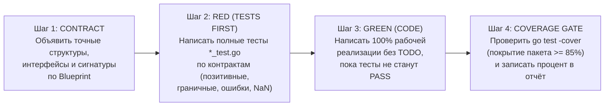

# Инструкция для субагента-исполнителя (WORKER GUIDE — Contract-First & Strict TDD)

> **Роль:** Субагент-Воркер (`Worker Subagent`).
> **Целевая модель:** `Gemini 3.8 Flash` (`High`).
> **Методология разработки:** **Contract-First + Строгий Test-Driven Development (TDD: Контракт → Тесты с покрытием ≥ 85% → Реализация)**.
> **Режим работы:** Ты выполняешь **ровно одну атомарную задачу (`TASK-XX`)**, порученную тебе Оркестратором, строго в рамках её области видимости (`Scope`).

---

## 1. Обязательный цикл Contract-First TDD (Сначала Контракт → Затем Тесты → Только потом Код!)

Категорически **запрещено** сразу писать бизнес-логику, а тесты дописывать «в конце для галочки». В каждой задаче ты **обязан** идти строго по 4 шагам TDD:



### Шаг 1. Фиксация контрактов и сигнатур (`CONTRACT PHASE`)
- Сначала создай целевой файл пакета и выпиши в него **посимвольно** все константы, структуры с JSON-тегами (`json:"..."`), интерфейсы и сигнатуры функций из раздела 2 (`Blueprint`) файла `./tasks/TASK-XX-...md` (с минимальными возвратами-заглушками только на этапе компиляции теста).
- Проверь, что все типы из `./pkg/contracts` импортированы и совпадают с межсервисными DTO.

### Шаг 2. Написание исчерпывающих тестов по контрактам (`RED PHASE — TESTS FIRST`)
**ДО написания бизнес-логики** создай файл `*_test.go` и напиши тесты с **максимальным покрытием (целевой порог `>= 85%` statement coverage)**, которые проверяют:
1. **Все контрактные сценарии из `Blueprint` задачи** (включая реальные строки логов `chat-com` и `chat-session`).
2. **Межсервисную совместимость JSON/HTTP-контрактов:**
   - корректную сериализацию/десериализацию (`json.Marshal` / `json.Unmarshal`) всех структур `pkg/contracts`;
   - для HTTP-серверов (`TASK-09`, `TASK-15`, `TASK-17`, `TASK-18`) — проверку статус-кодов (`200`, `202`, `400`, `404`), заголовков и JSON-полей через `httptest.NewServer` / `httptest.NewRecorder`.
3. **Граничные случаи и защиту от сбоев (`Edge Cases`):**
   - пустой вход (пустой слайс событий, пустой JSON-объект, отсутствие файла);
   - нулевая дисперсия / нулевой знаменатель в математических расчётах (проверка, что `SanitizeFloat` предотвращает `NaN` и `Inf`);
   - идемпотентность (повторная загрузка того же файла по `SHA-256`) и работа после очистки сырых логов (`purge-raw`).
- Запусти `go test` и убедись, что тесты компилируются и падают (`FAIL` — фаза **RED**), так как бизнес-логика ещё не написана.

### Шаг 3. Реализация бизнес-кода до полного прохождения тестов (`GREEN PHASE — IMPLEMENTATION`)
- Только после того как тесты написаны, реализуй 100% алгоритма в основном файле пакета.
- **Строгий запрет на подгонку под тесты:** запрещено хардкодить ответы под конкретные строки из теста — алгоритм должен быть честным и общим согласно правилам `Blueprint`.

### Шаг 4. Проверка покрытия и автоматический гейт (`COVERAGE & VERIFICATION GATE`)
- Запусти команду проверки из раздела 3 файла задачи (в ней уже проброшены кэш-тома `rca_go_cache` и `rca_go_build` для мгновенной компиляции) и **обязательно запусти автоматический скрипт проверки**:
  ```powershell
  py ./verify_task.py TASK-XX
  ```
- Скрипт `verify_task.py` автоматически проверит:
  1. Наличие и непустоту всех файлов из `Scope`.
  2. Полное отсутствие `// TODO`, `// FIXME`, `panic("not implemented")` и `os.ReadFile`/`io.ReadAll` на потоке логов.
  3. Прохождение всех тестов (`PASS`) и процент покрытия (`coverage >= 80%`).
  4. Для финальных задач микросервисов (`TASK-09`, `TASK-15`, `TASK-17`, `TASK-18`, `TASK-20`) — успешную сборку Docker-образа (`docker compose build <service>`).
- Запиши точный процент покрытия (`coverage: XX.X%`) и вывод `[VERIFY PASSED]` в свой отчёт в конце `./tasks/TASK-XX-...md`.

---

## 2. Золотые правила Воркера (Защита от галлюцинаций)

1. **Строгое соблюдение `Scope` (Области видимости):**
   - В начале каждого файла `./tasks/TASK-XX-...md` указан список файлов `Создавать/редактировать` и `Читать`.
   - **Категорически запрещено** редактировать файлы других микросервисов или менять контракты в `./pkg/contracts/`, если твоя задача — не `TASK-03`/`TASK-04`.
2. **Посимвольное соблюдение контрактов и сигнатур (`Exact Blueprint Match`):**
   - Имена пакетов, экспортируемых типов, структур, полей, JSON-тегов (`json:"..."`), сигнатур функций и маршрутов HTTP в твоём коде должны **посимвольно совпадать** с разделом 2 (`Blueprint`) файла задачи.
   - Следующие воркеры будут импортировать твои пакеты вслепую по этим сигнатурам. Любое переименование сломает сборку.
3. **Полный запрет на `TODO` и заглушки в финальном коде (`Zero Placeholders`):**
   - В готовом коде запрещено оставлять `// TODO`, `// implement here`, `panic("not implemented")` или возвращать пустые слайсы вместо реальной логики.
4. **Математическая и JSON-безопасность:**
   - Стандартный пакет `encoding/json` в Go возвращает ошибку `json: unsupported value: NaN` при попытке сериализовать `math.NaN()` или `math.Inf()`.
   - Во всех расчётах корреляций, частот, отношений роста и оценок (`TASK-11` .. `TASK-15`) всегда проверяй знаменатель на `0` и оборачивай каждый `float64` в `contracts.SanitizeFloat(v)`.
5. **Соблюдение бюджета памяти (1–2 ГБ RAM на весь стек) и офлайн-режима:**
   - В `ingest-service` запрещено вызывать `os.ReadFile` или `io.ReadAll` на входных файлах логов — используй только потоковое чтение (`bufio.NewReaderSize`, `json.NewDecoder`, `bufio.Scanner` с буфером 4 МБ).
   - Для работы с ClickHouse используй штатный HTTP-интерфейс (`http://clickhouse:8123`, формат `JSONEachRow`) через стандартный `net/http`.
   - Во фронтенде (`TASK-19`, `TASK-20`) не подключай внешние CDN, шрифты Google Fonts или внешние API — приложение работает на 100% локально и изолированно от сети (`air-gapped`).

---

## 3. Заполнение отчёта Воркера в файле задачи

В конце файла `./tasks/TASK-XX-...md` обязательно заполни блок **`## Отчёт о выполнении (заполняется субагентом-воркером)`**:
- **Дата выполнения:** точная дата и время;
- **Соблюдение цикла TDD (Contract → Tests → Code):** какие контрактные и граничные тест-кейсы были написаны первыми;
- **Созданные/изменённые файлы:** список файлов и количество строк;
- **Результаты проверок и покрытие (`go test -v -cover`):** статус `PASS` и точный процент покрытия (`coverage: XX.X% of statements`);
- **Заметки по реализации:** важные детали или исправления по замечаниям ревьюера.
